# Rim Prison

> **Proof of concept, work in progress. AI-generated.** The code, tests, art and most of these docs were written by AI
> coding agents (Claude via Claude Code, with reviews by Claude and GPT models), directed by one person. It passes
> automated in-game tests in a headless harness, but it has not had a line-by-line human review and is not on the
> Steam Workshop. Use it on a copy of your save. How it was made and tested, and what was not tested:
> [docs/HOW-IT-WAS-MADE.md](docs/HOW-IT-WAS-MADE.md).
>
> Community-made mod. Not affiliated with or endorsed by Ludeon Studios. RimWorld is © Ludeon Studios. Prison Architect
> is a game by Introversion Software; this mod is not affiliated with it.

A RimWorld 1.7 mod that turns the colony into a prison on the rim, in the spirit of Prison Architect. You are the
warden. The state, the penal authority of the settled worlds, lands a shuttle every day with new inmates (pirates,
raiders, slavers, yayo and flake smugglers, thieves) and pays for each one. Your staff run the place while you plan it,
set its rules and keep its books, and the inmates and staff live out their own stories inside it. Work in progress.
Requires [Harmony](https://github.com/pardeike/HarmonyRimWorld).

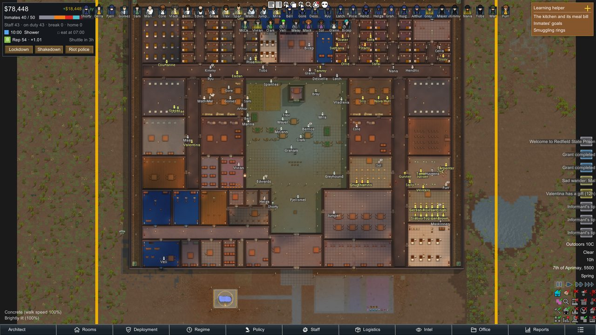

## Getting started

1. Install Harmony and this mod, and enable both (Harmony first).
2. On the main menu, choose **New prison**: pick a name, a facility and a difficulty, then **Open the prison**.
3. Read the welcome letter: it tells you what to do next for the start you chose. Then use the buttons along the
   bottom:
   - **Rooms** to paint zones;
   - **Regime** for the daily schedule of each security level;
   - **Policy** for rules, sanctions and the intake;
   - **Staff** to hire;
   - **Intel** for what you know about gangs, rings, trials and complaints;
   - **Office** for grants, the bureaucracy and buying land;
   - **Reports** for the statistics.
4. The overview (Reports, Overview) keeps a short list of what still needs doing; each line opens the screen where you
   fix it. The learning helper at the top right explains each system the first time it matters. Hover a grade tile to see
   what drove it that day and how far it moved ("Safety 72, down 8 - 3 violent incidents and no deaths among 40 inmates");
   the kitchen line under the history counts meals cooked, eaten and waiting, the hungry and the cooks on duty; "Show
   wings" swaps the needs for a table per level (inmates, mean tension, the tense, the ones held down by suppression, misconduct today, guards on the wing).
   The prison panel counts the tense inmates (a click opens Intel) and the letters waiting for an answer (a click opens the desk).
   The clock and the speed buttons (pause, 1-3) are the panel's top row, so every control is in one corner: the time of day, the day and season beside it, vanilla's own buttons to its right (the pause and speed keys as before); the bottom right keeps the weather and the temperature.
5. The difficulty can be changed in a running game from the storyteller page (Options, Storyteller): the Board is listed
   there with the difficulty buttons, so a prison that was switched to another storyteller can come back to it.

**An older save** keeps its own regimes: the schedules are saved with the game, so a prison started before the balance pass still has the 12-hour (Minimum, Medium, Maximum) and 15-hour (protective custody) nights that the pass shortened (supper at 21:00, protective custody at 07, 13 and 21). Open **Regime** and press the reset button to take the new schedules.

**Building a new facility:** before the first shuttle (at the hour set in Policy), build:
- a shuttle pad (Architect, Prison) and a holding room by the gate;
- cells, which are walled rooms with a prisoner bed and a toilet, painted as a wing in Rooms;
- a canteen with serving counters and tables, and a kitchen with a stove (painted in Rooms, the stove gets a meal bill by
  itself);
- showers and a yard.

After that, add an office with a desk and an administrator for the bureaucracy, and a morgue for the dead. Blueprints are
paid for when placed, the shuttle brings the materials, and power comes with a daily utility bill. Both are mod
settings, linked from the New prison dialog.

**The grounds and buying land:** as in Prison Architect, the prison owns a plot, not the whole map. The yellow line on the
map is its border, and you can build and paint rooms inside it only (the land outside is dimmed while the Architect or
Rooms screen is open; the toggle is with the other overlays at the bottom right). Staff, visitors and the shuttle's crew
still walk wherever they like. The inherited facility and the penitentiary own their walls, the road and the pad outside
the gate and a margin of 12 cells; a new facility owns an 80 x 80 square in the middle. When it is not enough, open
**Office, Land**: for each side of the grounds the state sells a strip 15 cells deep, and the price depends on its area,
on the land you already own and on the difficulty. Buying spends from the books and widens the grounds at once. The state
sells nothing while special measures run. An old save without grounds owns the whole map, as before. In dev mode the Land
tab (and the debug actions menu, Rim Prison) moves each side for nothing, and the New prison dialog lets you choose the
margin.

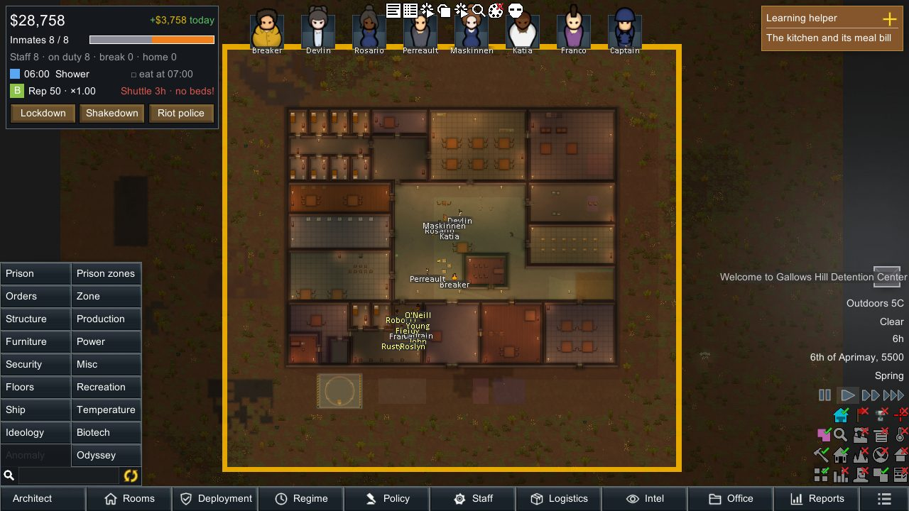

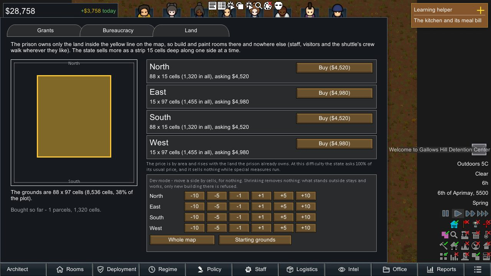

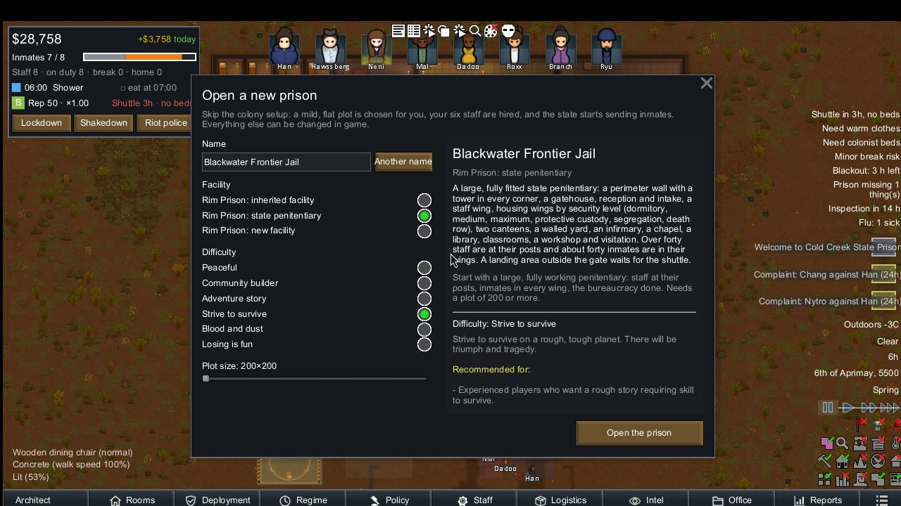

### Facilities

- **Inherited facility:** a small working prison inside a wall, with a gate. It has eight cells along a corridor with a
  guard station, a walled yard with a small chapel, the canteen and kitchen, showers, a common room and a library,
  visitation, a classroom and a workshop. By the gate are reception (with the administrator's office and a morgue),
  holding with two solitary cells, and a small staff room; the shuttle pad is outside. You start with seven staff: a
  cook, a doctor, two guards, a workman, a janitor and an administrator. Make it pay, then make it bigger: there is room all round it.
- **State penitentiary:** a large, fully fitted prison, staffed and holding about forty inmates. It needs a 200 x 200
  plot. Inside a 120 x 98 wall with towers in the corners:
  - a gatehouse, then reception and intake;
  - a staff wing with the camera room and the armoury;
  - housing wings by security level, from a dormitory to death row, with a small supermax unit in the segregation block;
  - two canteens with their kitchens and a freezer, and a walled yard;
  - showers, an infirmary, a chapel, a library, classrooms, a workshop and a laundry;
  - visitation and the parole hearing room;
  - the shuttle pad outside the gate.
- **New facility:** an empty plot and six staff. Build it yourself.
- **The old warden's problems:** a prison handed over built (the state penitentiary, the inherited facility) has a past, if the box
  in the New prison dialog is ticked (it is, by default). A dealer with a courier and an officer on the payroll, overdue debts, a
  feud, a tunnel already a third dug, a guard with a suspicion file, a complaint on its way and a gang holding the yard are in place
  from the first hour, all hidden until you find them, and the old warden's note is your welcome letter: two of its three hints
  are right and one is not.

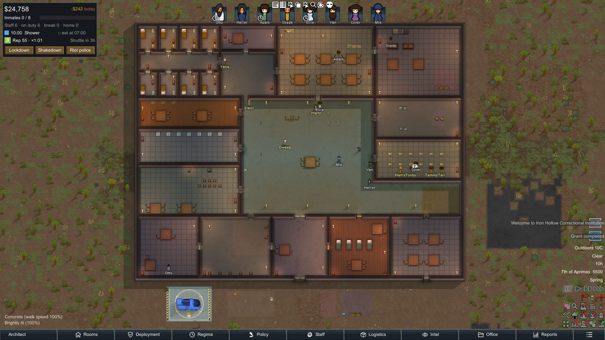

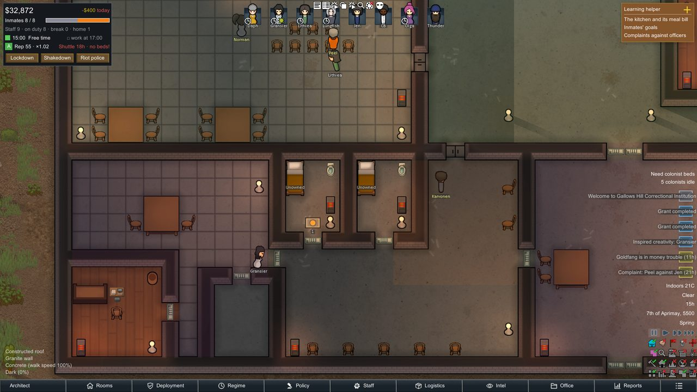

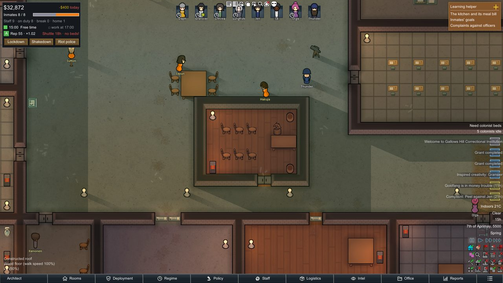

## What it covers

### Running the prison

Paint zones for wings by security level, the canteen, yard, showers, kitchen, workshop, classroom, visitation and the
staff room. Set each door's mode. Paint an hourly regime for each security level. Call lockdowns and shakedowns when
things turn.

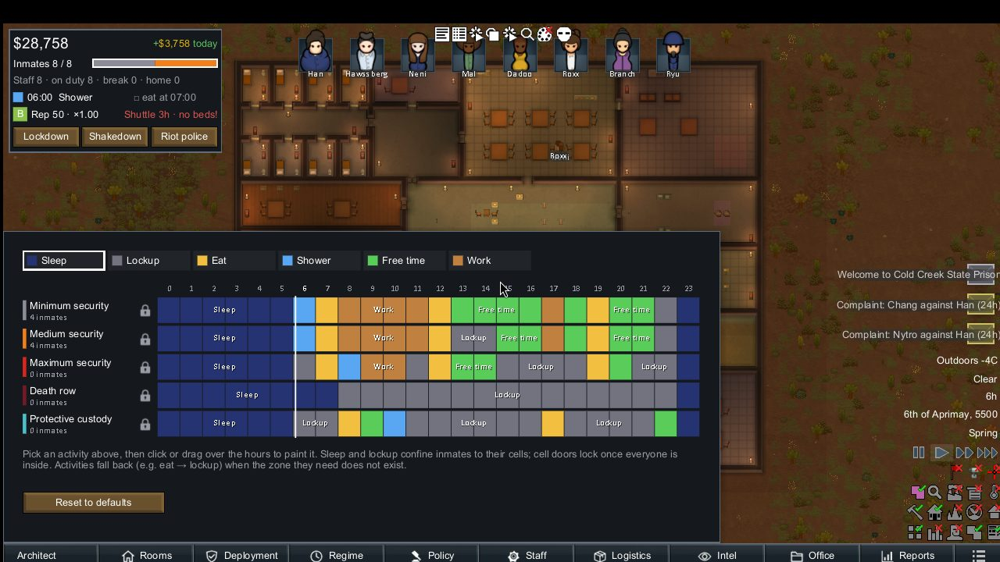

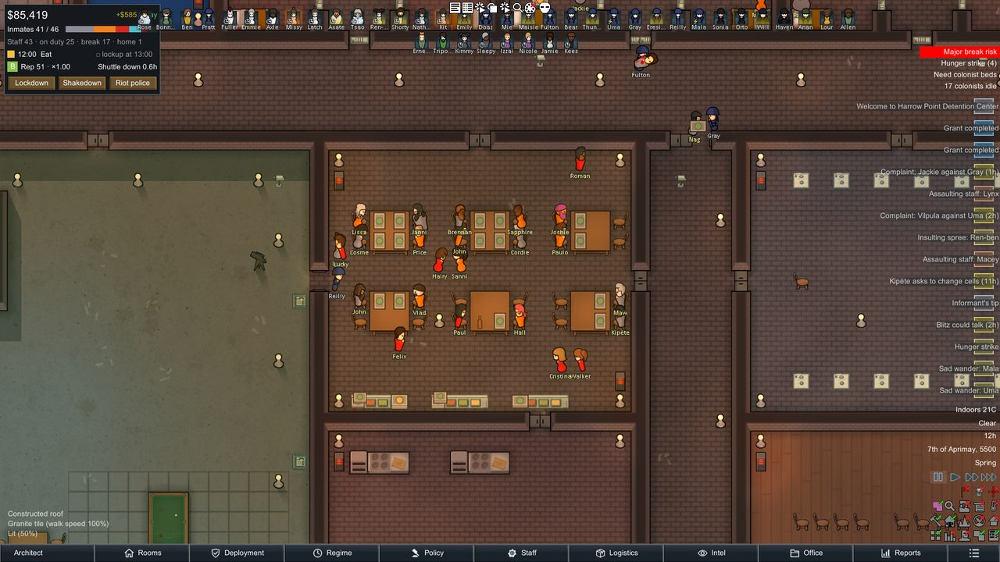

### The state shuttle

The shuttle lands on the pad you build, once a day:

- new inmates walk down the ramp to guards who take them to holding; the state's own prisoners, rearrested ex-inmates and
  recaptured escapees, come first, with a line of their own;
- supplies come on it, or on a cargo run between the daily shuttles;
- exports leave on it, and the released board it; a transferred inmate is walked to the ramp by a guard;
- the dead go home on it: guards and workmen carry the body of an inmate or a staff member to the morgue, and what lies there
  at lift-off leaves with the shuttle. The family writes to you a few days later, bitterly if the death was neglect or
  at the hands of your staff. With no family to send for them, workmen bury the dead in a burial plot, if you paint one on
  bare ground.

Storms and threats can delay it. Stowaways can try to slip aboard, and the cargo crew may be smuggling. A guard on pad
duty watches it.

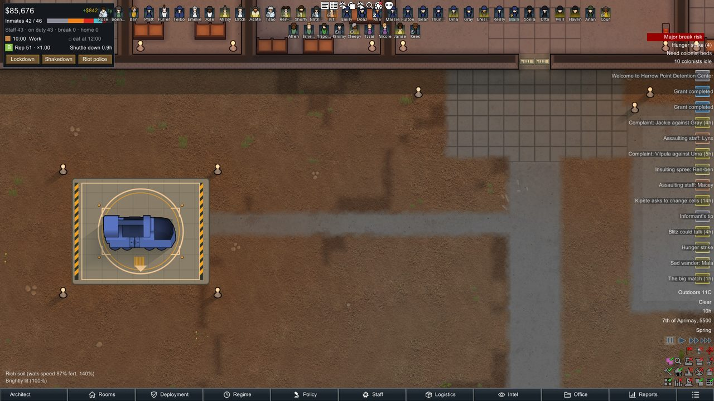

### Inmates

- **Tension and needs:** tension has causes. Needs cover hygiene, bladder, family, a clean uniform, faith, exercise on a
  weights bench, and literacy from library books.
- **Suppression:** solitary, long confinements and the warden's firm word hold inmates down: fewer incidents, but above 50
  they are shut out of programs, cannot join a riot and calm at half speed. The wing table counts the ones held down, the
  weekly report names the wings, the Programs screen says when suppression is why a class has nobody, the Policy tab's
  sanction tooltips give the suppression an hour and what the hours come to, and an inmate's file reads "clear in 4 days".
  When a tense wing has a quarter of its inmates about to come out from under suppression, a letter warns a day ahead and the wing's riots are twice as
  likely for the day after (once in five days per wing).
- **Gangs and reputations:** inmates have reputations and gangs. Gangs hold turf and fight wars over it. They have ranks
  (member, lieutenant, leader): when a leader goes the lieutenant takes over, or two of them fight it out. A member can
  come to want out (a birth in the family, a mentor, a program passed, a friend lost in a war): the chaplain or a
  counsellor hears them out, they renounce the gang, and the gang puts a green light on them (a threat, then a beating)
  until you move them or protect them. An ex-member is hated by the old gang for thirty days. A search or a frisk can
  find a gang's tattoo.

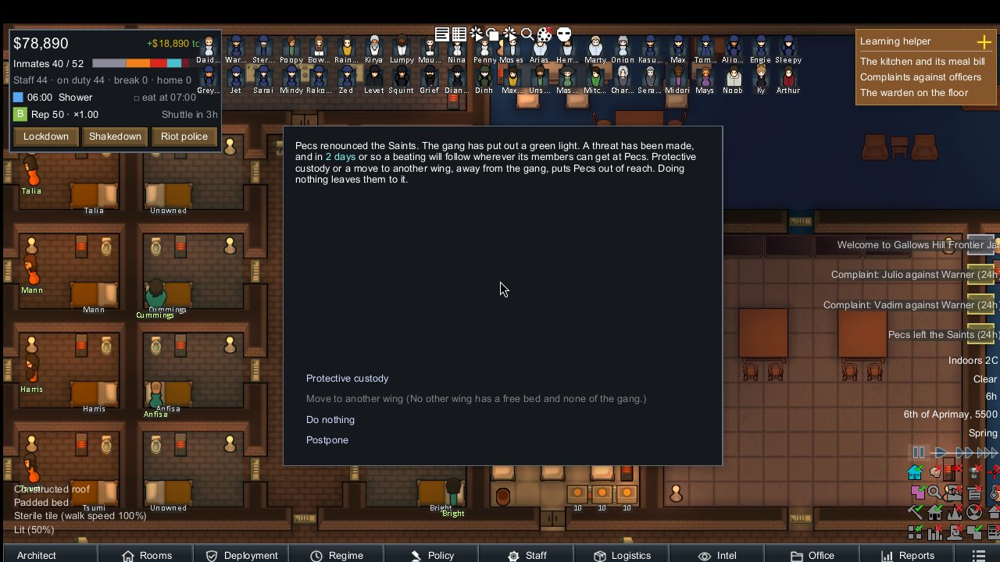

- **The shot-caller's deal:** once you know a gang and its leader, the warden's word with the leader offers "keep your
  people quiet" for ten days: the gang's members on the leader's wing misbehave far less (0.6 of the odds), the gang
  starts no war and recruits nobody, and the other gangs on that wing are wound up by it ("the Ravens run the yard").
  The leader wants one thing for it, your pick of four: a patch of the yard or common room as the gang's turf, two
  visits a week for its members, the commissary open to them, or a job for the member they name. It is a mark against
  the prison: the inspector scores it five points lower while the deal runs, and the press may tell it. A fight or an
  assault a member is seen in breaks the deal: overlook the first, or end it (the leader will not forget it); the
  second ends it. Intel shows the deal on the gang's row with an "End it" button, and a new deal with the gang waits
  five days.
- **Misconduct:** from insults to riots and tunnels. Inmates keep contraband and cell stashes, and make some of it
  inside: hooch brewed in a cell from fruit stolen in the kitchen, and a patch of smokeleaf sown in the garden by a
  gardener who is inside for it, which can become a dealer's own supply.
- **Tools counted back in:** the workshop and the kitchen are issued tools by their benches, and a theft at work takes
  one out of that supply and carries its room and work period with it. At the end of each work period a guard or a
  workman counts the tools back in; only then is a shortage known, as a message and a letter with the room and the
  period and never a name. Ask for a supervised re-count (the next period starts an hour late and nothing goes missing
  in it), a search of the crew (it starts two hours late), or carry on short (the room's output is down until you
  replace the tools from Intel, or one turns up in a search, a stash or a tunnel and says where it came from).
- **Smuggling rings:** behind the contraband are rings made of a dealer, couriers, a relative outside and an officer on
  the take. You find them link by link, then bust them, wait or turn a member.
- **Men and women:** they are kept apart in the cells (a mixed cell counts as a clash, and the daily review splits it),
  and each wing can be set to all inmates, men only or women only in the Intake tab.
- **Keep-apart orders:** pick two inmates the prison must keep apart (a "Keep apart" button on an inmate's file, and on
  Intel's feud, trial and debt rows). They are never put in one cell, in different wings when a bed allows (the daily
  review moves one of them), not in the same patch of a yard or canteen, not in the same class or job room (when that leaves one of them with no job, they have the room in turn, day by day). The file and
  Intel list each order with its reason and since when, and say so when it cannot be kept ("no bed for Vance on
  another wing"). The trial letter, the green-light letter and the debt letter offer the order as an answer, and so does
  a granted cell request. Up to 60 orders; one whose inmate has left is dropped. The compliance grade does not read it.
- **Drug testing:** a Policy row - none, targeted (after a contraband find, a tip, an overdose survived, and in the two days before the inmate's next hearing or trial) or targeted plus 1-6 random tests a day. A doctor on duty (the day shift's work hours; never the night doctor, never the only one on site, two tests an hour at most) takes the inmate aside with a kit from the supply company; a riot or a hostage crisis stops the round at once. A positive (a drug in the last two days) is a seen drug use on the record (confinement to the cell by default), a substance abuse referral, lower parole odds and, for a dealer's customer, maybe a lead on the dealer; an addiction with no recent use is a positive for dependence (the referral and the parole odds, no punishment); a refusal is a misconduct of its own (four hours in the hole by default). A positive or a refusal counts against parole for five days. The file shows the last test; Statistics counts them.
- **Funerals:** when a body is laid in the morgue you are asked once: a quiet burial (what no answer is) or a funeral. A funeral is held at the next free-time or work hour (never at night, never in a lockdown or a riot; it waits up to a day and then is a quiet burial) at the grave, or in the chapel, or at the shuttle pad for one going home. The chaplain comes, and the dead inmate's friends and gang mates are let out of the regime for the hour, with the guards who escort them (busy for the hour, one for five mourners); their family comes as visitors if the visitation room can bring them. A good day for the wing and the friends (a thought, less tension) and a gang's show of strength (the turf count leaves them out); a rival of the killer's gang on the wing may turn up and start something. A colleague's funeral is the staff's: colleagues on duty attend, the warden speaks, morale goes up.
- **Rooms kept for a level:** each patch of a shared room (a yard, a canteen, the showers, a classroom...) can be kept for
  chosen security levels in the Rooms tab ("kept for all" by default). Inmates go to the nearest patch they may use, eat in
  an allowed canteen, take classes only where every seat is open to them, and count as out of place in a patch kept for
  others; assigned work goes anywhere, and an urgent toilet or meal falls back to the nearest when nothing allowed is left.
- **Cells by conduct:** every cell has a grade from 0 to 5, from its impressiveness (a lamp, a rug, a good floor, room to
  move; a shared cell is capped: a dormitory is a 2 at the most, a double a 4). Each inmate has earned a grade: one step
  for every five clean days or a passed program, two lost for a seen fight. The daily review moves an inmate two or more
  grades from what they have earned (up to a better cell, or down), never into a cell with a rival, an enemy or an
  extortioner, and the safety moves come first. The Rooms tab shows each cell's grade and the prison file what the
  inmate has earned and what earns the next step. Policy, "Cells by conduct", turns it off.
- **Ex-inmates come back:** a released inmate with a trade, a passed program or a friend inside may write a week or so
  later asking for a job (cook, workman or gardener, never a guard): their honesty starts from their record, the old
  gang may lean on them, and friends inside are glad. They may also visit a friend inside as themselves.
- **Programs and parole:** inmates take programs. Parole means a hearing room with a board and speakers for and
  against, then life on parole. There is also remission, and death row.
- **Restorative meeting:** for an inmate inside for a violent crime who has passed a program (or wants to make amends,
  a goal of its own), the counsellor may propose a meeting with the victim's family. The letter states the fee, the
  counsellor's hours and the odds, and what makes them (the inmate's tension and traits, the counsellor's Social skill,
  the programs passed). Approved, a relative of the victim comes to the visitation room (searched at the gate like any
  visitor), the inmate is brought as for a visit and the counsellor sits with them. If it goes well, the family withdraws
  its letter to the parole board or even speaks for them, tension falls and the chance of reoffending drops a band. If it
  goes badly, the family writes against them at every hearing, the press may hear of it, and tension spikes. Once a stay;
  the fee comes back if the meeting never happens or the inmate leaves first.
- **Class bookings:** each program on the Programs screen has a Book button: reserve hours of the day for it, in a room
  you choose, so that a scarce classroom and counsellor go to the class you want (a small rehabilitation class over a
  fuller one) and not to the fullest. A booked class is tried first at its hour and the automatic scheduler fills the
  rest. When it cannot run (no teacher on duty, the room gone or not open to those who could attend, a meal or lockup
  for them, nobody eligible) the miss is kept with its reason on the row, three in a row put a warning on it, and
  nothing is cancelled or charged.
- **Custody contracts:** every week or so, once the prison has a classroom and a counsellor, the state offers a custody
  contract: three to five minimum or medium security inmates to rehabilitate. The letter shows their official file (levels,
  crimes, terms - never a gang or a claim of innocence), the fees and bonuses, the class sessions asked of each in their
  first seven days, and what that asks of your classroom and counsellors against what you have. Decline, prepare the
  beds and rooms first, or sign: the cohort comes on the daily shuttle, the state pays a fee on each admission, and a
  bonus at the end of each inmate's own week for each who attended the sessions. Fewer sessions, no bonus; one who is
  released, transferred, escapes or dies first forfeits theirs and nothing more. The Intake tab follows each inmate's
  progress. The state does not send a cohort while its special measures are on.
- **Release preparation:** the Intake tab lists the inmates within five days of release or of a hearing, with what is
  known of their job and housing, and the warden can fund lodging (paid when they leave, if the money is there - a
  promise nobody funds does nothing), arrange a job interview on a certificate from the vocational courses, or leave
  them to what they have. Each administrator or counsellor handles three such cases at once. Nobody is judged at the
  gate any more: after they leave, a daily review for a week (a parolee's term, five to fourteen days) rolls a small
  risk that adds up to the old chance. Parolees write ordinary letters, and word comes of an actual setback - a job
  lost, an address withdrawn - which the warden can pay to help with once; it mends about six times in ten, and
  nothing paid undoes a new offence. The reoffence, the board's trust and the reform grade move only when the outcome
  is seen; releases still under review are listed apart.
- **Vocational training:** a tailoring course (the classroom, then a tailor bench in the workshop) certifies a trade
  and opens tailoring work, which sews uniforms to sell at the export run (the surplus also refills an empty clean-uniform
  stock before the outside laundry is paid); kitchen safety, held in the canteen, is needed
  for the kitchen job and makes food scares less likely. A certified trade gives a parolee better odds of a job in
  place and a lower chance of reoffending.

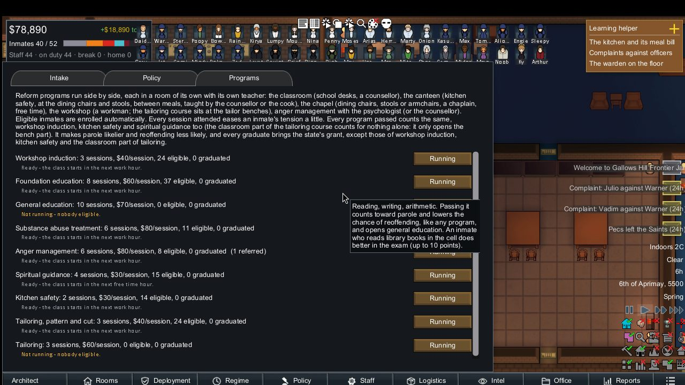

- **Supermax:** the level for the worst. Once you have the supermax clearance (a bureaucracy project after maximum
  security) a staff killer, a convicted murderer and a hostage ringleader are moved to a free supermax cell, and you can
  send anyone yourself (at the maximum rate of pay: the rules' sends pay the supermax rate). They live in one cell with
  the meals brought to it, and leave it only with a guard, who opens the doors on the way and no others: a walk to a
  shower with nobody else in it and an hour alone in a yard of their own, in several hours a day (a yard patch takes one
  inmate at a time: build more patches for a bigger unit). One left outside the cell is fetched back. No parole from
  there. A long stay wears them down (lower mood, an earlier mental break). After ten clean days you are asked
  whether to step them down to maximum.

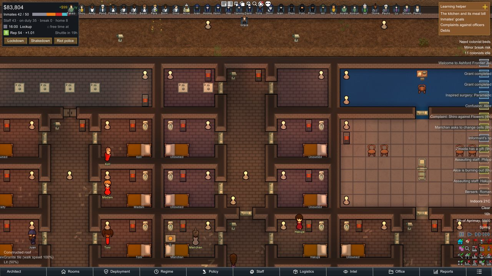

- **Psychiatric care:** the criminally insane. After the psychiatric wing project (which follows psychology) the
  psychologist moves an inmate to a padded cell of the psych wing after two mental breaks in ten days, or for a trait
  such as pyromaniac at the first assessment. A break in a padded cell harms neither the inmate nor the things in it. The
  doctor makes medication rounds with an antipsychotic (buy it from the supply company): while it lasts breaks are
  rare, and when a round is missed it fades and a break comes. No workshop and no kitchen for them. The penitentiary has
  two padded cells beside its medical ward.
- **Inmates at risk (the watch list):** an inmate whose mood has been very low for a day after bad news (a Dear John
  letter, a death in the family, parole refused, a green light, a long supermax stay, a beating over a debt, a life
  sentence) is flagged by the psychologist, their unit officer or a guard, and one letter asks what to do: a watch (a
  guard looks in every half hour, their belongings are taken and they stay out of the yard), a padded cell, counselling
  sessions, or nothing, for three days or until the mood recovers (stopping the measure early leaves them at risk). Left
  alone, or on a watch the guards do not keep up, a rare crisis can end in self-harm unless someone on the staff reaches
  them in time; a mod setting turns crises off. Intel lists who is on the watch list.

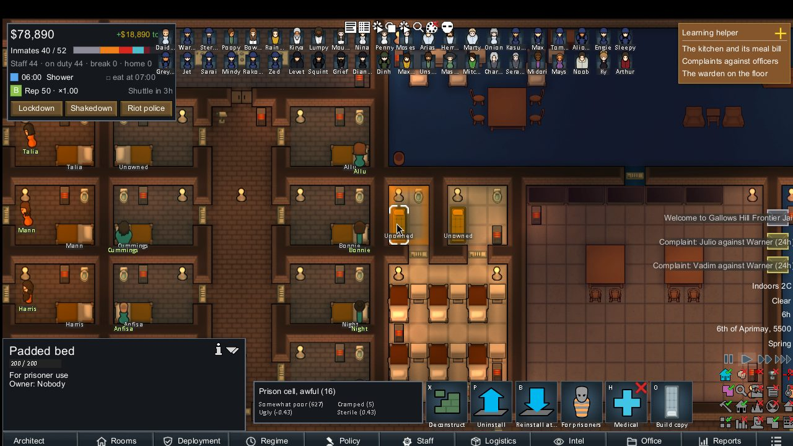

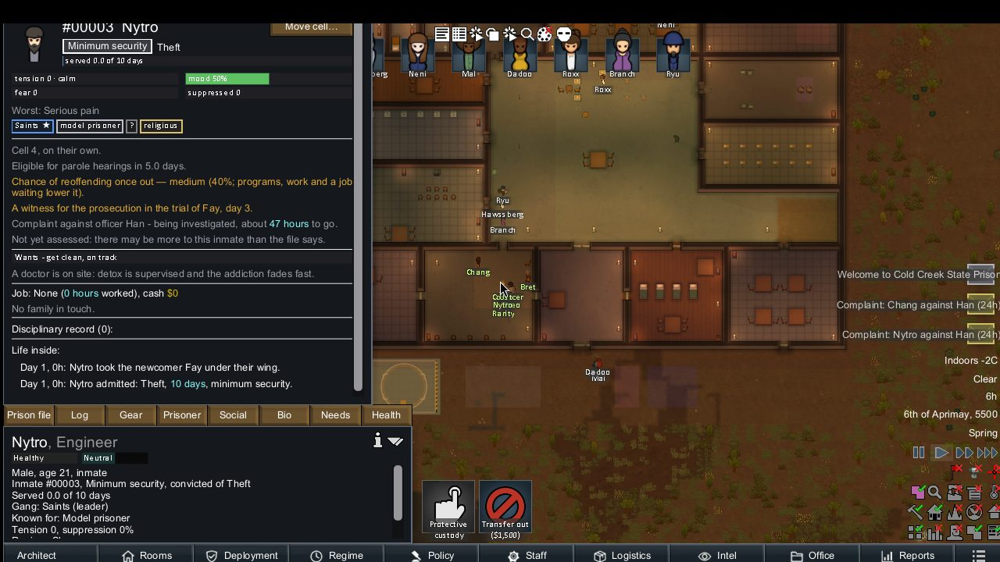

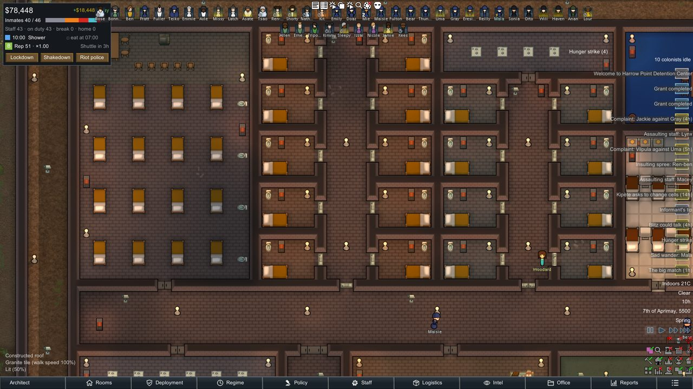

- **Growing old inside:** inmates age, and the chronic conditions of age (a carcinoma, a blocked heart artery,
  frailty, dementia and others) come with a letter: treat it (a surgery, or palliative care for a dying inmate, with
  a hospice bed in their own wing and the chaplain once a day), transfer them out, release them on compassionate
  grounds (over 65 or dying, half the sentence or a long stretch of a life term served, never from death row), or do
  nothing. A treatable condition left alone that kills them brings a state inquiry. A lifer who dies of age after
  years inside is a milestone, and the family writes.

### Staff

- **Roles:** guards (patrols, frisks, cell searches, restraints, armed response, dogs, towers), cooks, workmen,
  janitors, doctors, counsellors, a psychologist, a chaplain and administrators.
- **Choosing who you hire:** a click on a post in the Staff tab shows the people who applied for it - their skills for
  the work, the work they cannot do, their traits and age - and you hire one of them, for the post's fee. A recruitment
  round lasts three days and brings up to three applicants per post, the same ones however often you look. An agency
  hires somebody at once for twice the fee.
- **Working life:** staff work shifts and commute. Their morale changes how well they work. They take training courses
  and breaks in the staff room.
- **Trouble:** corruption, burnout and memories of danger.
- **Kin across the wall:** now and then a new hire is the parent, child or half-sibling of an inmate, or a new
  arrival is related to someone on the staff. A letter asks whether to keep a guard away from their relative. A guard
  may hesitate to restrain their own kin when another guard could go. A fixer finds an officer easier to bribe when
  their gang holds that officer's relative. A death on either side of the wall is felt on the other.
- **Unit officers:** the Deployment tab has a slot per wing for one guard who knows it. The officer patrols the wing,
  and day by day its inmates who see them come to trust them (being around makes acquaintances, not forgiveness: an
  inmate who resents them gains nothing from it); they notice things and now and then bring a hidden fact about the wing
  to your desk (a tunnel, contraband, a gang tie, a debt), and fewer complaints are filed against them there. The longer they stay, the more the wing's fixers count on knowing them. Moving them, or taking them off, starts
  the days again; a guard kept off a wing for their kin cannot be named to it, and the row says which shift the officer
  works (an officer on days leaves the nights uncovered).
- **The roster:** the Staff tab shows a 24-hour strip of how many guards are scheduled on duty in each hour (and how many off-shift staff are still on site), and each guard has a
  shift pin (auto, days or nights). A guard pinned to nights is one of the third who work nights; the rest are filled from
  the guards you have not pinned, so the brutal guard, the corrupt one or the kind senior one is where you put them. A
  handover of up to three hours keeps the day guards on past 22:00 at one and a half times the hourly rate, paid at midnight
  for the hours they worked, a line of its own on the wages account. A guard who works nights seven days running resents it ("nights again"), and is glad of a fair
  rota when taken off. The Deployment tab shows the strip too, and each guard post's row says how few guards are on duty in
  its hours.
- **Staff agreements:** when the staff send their demand letter you can pay the bonus, refuse (they walk out), or agree to fix
  what they are angry about - one more guard on duty at every hour, fewer of the staff stuck on nights, nobody hurt, or a ten percent rise - and be held
  to it for five days. It is measured hour by hour from who is actually on site and on shift, so cover added for the last hour does
  not count; the rise cannot be taken back for twenty days without breaking your word. A kept promise is fifteen days without a demand over it and a good memory; a broken one is a bad memory, no
  peace, and no bonus offered next time. One promise runs at a time; the Staff tab tracks it, and the rise can be taken back there.
- **The count:** twice a day by default (at lockup and at six; Policy sets none to four, and the hours follow the regime's lockup hour) the guards on duty walk each wing and count heads, half an hour a wing at most. The HUD says
  "count cleared 22:10" or "count: 2 unaccounted", and an alert names who is missing and where they were last seen. An escape that no guard, camera or tower saw (a tunnel in the night, a stowaway with nobody on the pad, a
  walk-off through a gap) is not known until the next count finds the cell empty, and the police's head start is what the count left them: every hour of it costs the odds of getting the runaway back. An inmate out of place at
  the count is written up. With no guard free in the hour the count is missed (a line in the chronicle, and the runaway stays unknown a little longer); with counts off in Policy an escape is known the moment it happens.
- **The regime, pulled:** the Regime tab shows yesterday under each level's row, hour by hour - how many stood where the slot wanted them, a dot for a misconduct and one for a meal missed (hover for the numbers; they are not kept across a load, and the tooltip says so). A "Today..." button on each row opens today's orders: call off the yard today, lock up early today, a second shower today - each lasts until midnight (a tag beside the level's name says what is in force), with a line in the chronicle, and the timetable is untouched. The inspector and the weekly report notice a level the warden keeps in with orders on more than three days of seven. The inmates' demands now name the timetable when it is the outdoors or joy they are short of: the spokesperson asks for "a second yard hour" for a wing, and you are held to it by the schedule the wing ran in the last day of the promise, not by how the need came out. The inspector writes down a wing locked up more than 20 hours a day.
- **The warden on the floor:** you have a member of staff of your own, in every prison. Select the warden to address the
  canteen (calm or firm), walk a wing (inmates trust or resent it; a snitch may tell them something, a complaint is said to
  their face) or have a word with an inmate (back a goal, sound them out as an informant, tell them where they stand before
  a hearing). They are never let go or sent home, sleep in a cot of their own, and are the one a riot goes for.
- **Asks to see the warden:** inmates with a reason ask to see you - a trial witness who was got at and trusts you more
  than the guards, a debtor after a beating, a member of a gang you know who has doubts, a hunger striker, a step-down
  candidate in supermax, a cell request, someone on a wing where a false rumour is going round. The prison panel counts
  them ("3 ask to see you"); Intel lists each with the reason, the hours left (a request lapses after a day) and "Go" (a
  word with them, or the walk of their wing for a rumour). Answered in person it does more than a plain word or walk -
  more trust and calm by a word, twice the trust on a walk - and the reason's own: the witness tells you they were
  threatened, the doubter is heard out as the chaplain would, the rumour's source is named and shown false.

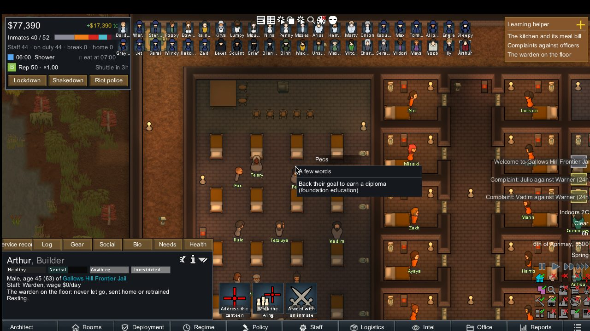

- **The colonist bar:** the staff are grouped by role (the warden, security, medical, programs and office, upkeep), each
  group labelled with its name and headcount, and the prison panel's "Bar" button makes it compact: only the warden, the
  staff you pin (select one, "Pin to the bar") and anyone who needs you now (down, in a break, bleeding, on fire, held
  hostage). Click a group's label to collapse that group alone to its pinned and needy members ("+ Security 19"); click
  again to open it. A mod setting turns the grouping off.

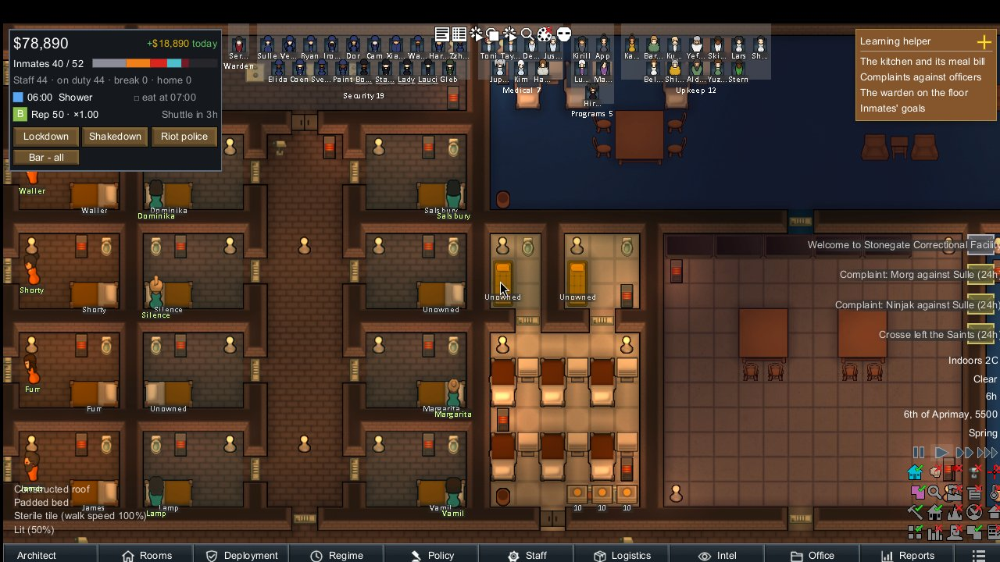

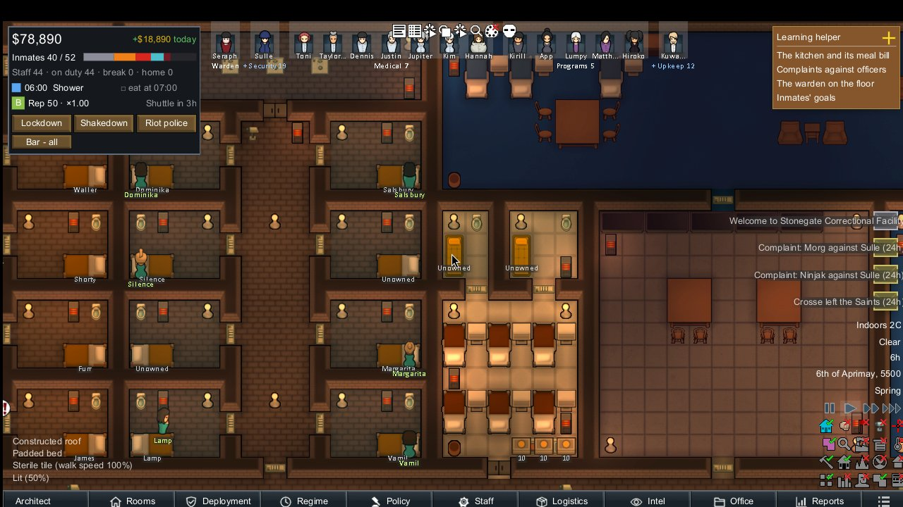

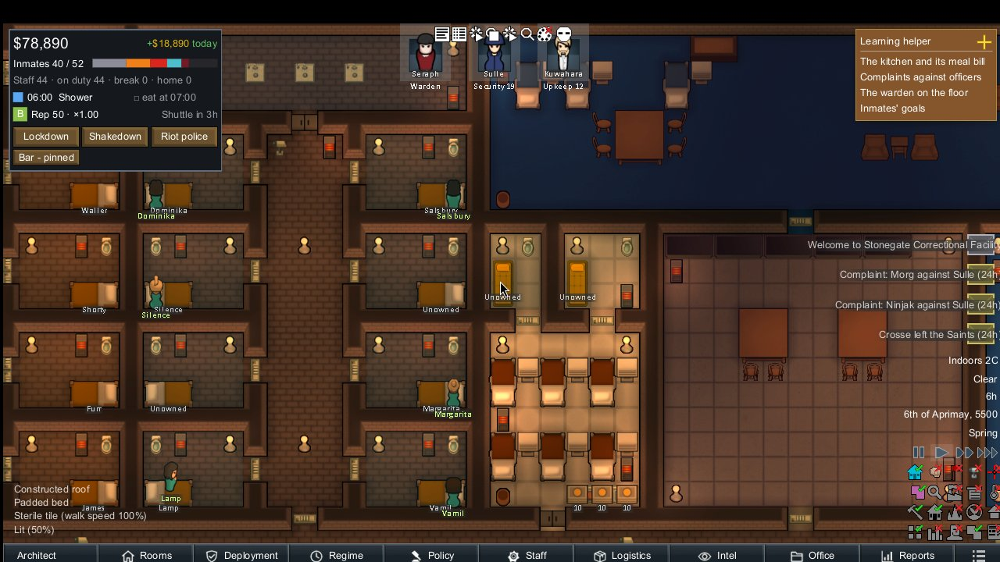

### Intel, courts and complaints

What you know is what your staff saw, your informants told you, the psychologist found out or the cameras caught.
Hidden gangs, debts and rings stay hidden until then.

- **Trials:** a killing inside goes to trial. The case is built from who saw it, a camera and the killer's record. The
  killer's gang may get at the witnesses. You can put witnesses in protective custody and call a known informant to
  testify, then the court gives its verdict.
- **Tasking an informant:** a known informant's file has "Task...": pick an inmate to watch (the ones you already suspect
  come first), then move the informant into their cell, onto their wing, or leave them where they are. Their tips look at
  the target first, but every day in place (near the target) makes it likelier they are found out, faster when the
  target's gang is on the wing, and one who no longer trusts the warden may feed you a wrong lead. Intel shows the days in
  place and the exposure risk, with a "Pull out" button; the target stays wary for a while after you pull them out.
- **The rumour mill:** a cell search, a transfer, a death on the wing, the yard called off, an early lockup or a
  restriction, a food scare, a staff strike or a send to supermax can start talk on the wing it touches, and some of it
  is twisted ("they're shipping the whole wing to supermax"), more so on a tense wing - though "the guards killed Hale"
  may be the truth. It spreads at meals and in the yard, fades over two days, and winds the whole wing up meanwhile ("a
  rumour - the yard is being closed for good" on their files). Intel lists them: the warden can calm the wing's canteen
  (a false rumour ends at once, a true one only quietens), speak firmly (it sticks a day longer, once), walk the wing to
  find who started it, or let it burn out; an informant may name the source. Lifting an order makes its talk false. A
  riot's letter and the next morning's incident report say what the wing was saying when it began.
- **Complaints:** inmates may complain about an officer, whether it's true or not. You uphold, dismiss or investigate,
  and the outcome reaches into discipline, careers and lawsuits.
- **The adjudication sheet:** Policy, "Adjudicate the serious" (off by default). With it on, a seen offence of severity 3
  and over (an assault on staff, an escape attempt, a riot's ringleader) takes no sanction from the table. It becomes a
  case, and one letter a day, at the first morning hour, lists yesterday's cases (six at most) each with its evidence - who
  saw it, a camera, the weapon, the record - and four answers: the policy's sanction; loss of remission (the days they
  earned come back onto the sentence); days added, up to 30 (an officer's or a camera's evidence makes them stand, and
  without it a jailhouse lawyer in the prison appeals and has them struck out, at your cost); or, for an armed assault on
  staff, a charge, and the state's court sits for it as for a murder, with a shorter sentence. A case left unanswered takes
  the policy's sanction. Days added are days of pay from the state, and the inspector writes down a warden who piles on more
  than 60 in a week. The file shows the sentence with the days added.
- **The morning after a riot:** when a riot is over, the next morning brings its incident report: the ringleader and who
  joined (named only if a guard or a camera saw them, the rest a count), who was hurt or killed, the value of what was
  broken, the grievance shouted and whether it was real, and what the prison lacked (no guard near, an unlit spot, few guards
  on the roster for the wing). You give up to two answers: restrict the wing for 1-3 days (no yard and an early lockup; the
  wing riots less meanwhile, and each day served holds it down more, which past the line shuts it out of programs; the
  tension comes back when it ends), ship the ringleader out, charge the ones seen who were not already punished or put on
  the adjudication sheet for it, make them pay for the damage out of their cash, or meet the grievance with a promise. Amnesty
  must be your only answer: the wing calms, but you lose reputation and they riot more readily for a while. Intel lists
  the last ten riots with what you answered.

- **The danger map:** one more overlay at the bottom right. It marks where violence was seen in the last 30 days, fights,
  stabbings, assaults on staff, riots starting and deaths, and the Deployment tab names the three hottest patches, so you
  know where to post guards and cameras. A fight no guard or camera saw is not on it.

- **The dark:** at night an unlit yard corner or corridor is only seen by a guard within three cells, and a camera sees
  nothing there (a tower's searchlight still does); lamps are security. The coverage overlay shades the dark, and the
  Deployment tab marks a hot patch "unlit". One working camera is enough to watch a spot by day, for misconduct and for
  the covert economy alike.
- **Guard posts:** place a guard post (Architect, Prison) and give it hours ("12:00 to 14:00" for the canteen at lunch, or
  all day) and, if you like, a named guard. A guard on shift who is not on a tower stands there and watches the spot; a
  fight, an escort or a search still comes first, and the state's security chief suspends the posts while in charge.
  Each hot patch on the Deployment tab has a "post a guard here" button.
- **A care detail:** on the Deployment tab, keep up to three guards for care. They are picked each hour from the guards on
  duty (those already feeding or carrying first) or named by you, and they bring the meal to the inmate shut in a cell, feed
  and carry the injured and walk a supermax inmate back to the cell, while the others answer the trouble: a reserve guard
  takes no restraint, search or alarm unless an inmate acting out is close to them or to the inmate they are tending (an
  escape, or trouble aimed at the staff, is answered wherever it is), and one guard on duty always stays outside the reserve
  (naming a guard overrides that, with a warning). The tab shows who is on it, who you named and cannot serve (off shift,
  suspended, on strike, on a post, drafted), and the oldest care waiting; "release the reserve" lets it go for the hour and
  says what will wait. Doctors still do the medicine, and with none kept (the default) nothing changes.
- **Evacuating a wing:** on the Deployment tab mark up to two assembly points (a yard, a kept room or the holding patch) and
  which security levels each takes (supermax goes only to a cage of its own, one at a time, or waits in the cell). When a
  fire reaches a wing with people in it (the solitary cells beside it count as the wing) you are offered to evacuate it (the
  tab has the button too; nothing starts by itself): minimum and medium inmates walk to a point on a route of their own,
  where only the doors on that route open for them; maximum, supermax, the hole, death row, the downed and anyone with no way
  they may walk alone wait for a guard (or a doctor) who walks or carries them out. The roll call shows who has arrived, who
  is carried, who waits for an escort, whose route is blocked and who is missing; a second point keeps one of each kept-apart
  pair or feud, protective custody and the threatened apart. Nobody is sent into fire - with no point they can reach they go
  to the nearest safe room. A downed inmate at the point may be taken on to a medical bed outside the wing, and stays there
  until well. An hour after the last fire, or on your word once the wing no longer burns, everyone goes back to their own bed and
  the passes end; a fire in the wing on the way back turns everyone out again. A drill runs the same without a fire (a small mood memory for each inmate moved, once a day, not in a lockdown or a
  riot; a real fire takes over from it; once a day means a day after the last one began) and its letter names the slowest arrival and any route that was blocked. Door modes,
  lockdowns, punishments and bed owners are left as they were.

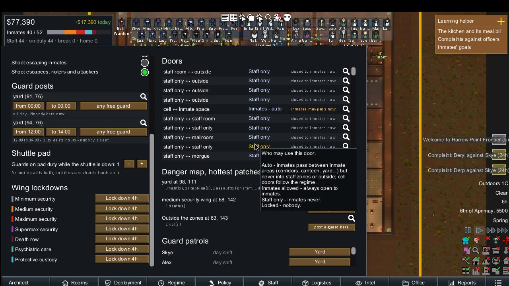

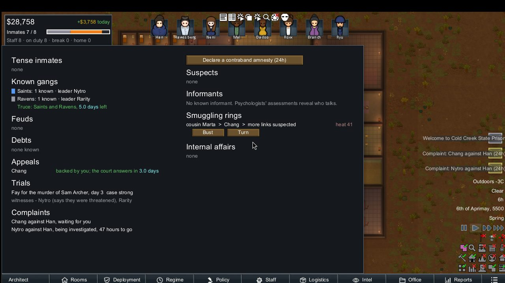

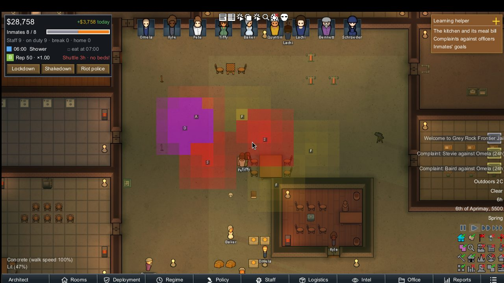

### Economy and the state

- **Money:** a ledger, supplies by shuttle, construction costs, grants and land bought from the state.
- **Bureaucracy:** projects that unlock more of the prison.
- **Income:** inmate jobs and exports, export contracts and the commissary. A state loan is there when it all goes
  wrong.
- **Pay by the grade:** from day 8 the state's per-diem follows the last week's report cards - A +15%, B +5%, C the
  plain rate, D -10%, F -25% - on top of what reputation earns. The grade's tooltip on the overview says what it is
  worth ("+$120 a day from your B" in a 24-inmate prison), and so do the ledger's per-diem line and the weekly report.
- **Special measures:** the state steps in when the prison fails. It sends an overseer and sets a deadline. It caps the
  shuttle, lowers payments and locks policies. In the end it sends its own security chief.
- **Flagship status:** a prison that excels becomes the state's flagship, with legendary transfers and better grants.
- **Inspections:** a state inspector gives notice a day ahead, then walks a wing, the canteen, the kitchen and the yard and writes down up to five things only you can put right - a dark corner where a fight was, bare cells for inmates who earned better, thin cover on the nights, a room that is missing, a body the morgue cannot take - each with a deadline, as lines on the
  overview's to-do list. They read what the prison had when the notice came, not what is arranged for the visit. Five days later they come back: a grant for each thing put right and kept so through the last day, a fine for each not.
  The deep clean still lifts the grade, and the envelope still buys a clean report - until it comes out, and the letter names what was left out.

### Life and story

Decisions arrive as letters: inspections, strikes, food scares, fires, appeals, mentorships, inmates' demands through
a spokesperson, and many more. A chronicle and a weekly report remember what happened.

- **Standing orders and the desk:** a routine letter (a funeral or a quiet burial, the adjudication sheet left to the policy, a custody offer, a
  mentorship, a talent show, a family day) has "Do this from now on" beside its answers. Tick it and answer, and later letters of
  that kind are answered the same way the moment they come: they use none of the day's budget of decisions, and a message with a "Review" link
  opens the letter as it was answered. An urgent letter, or one whose answer is not open for its case (no money for the show, no place for the
  funeral), still comes to you, with a line saying why. Policy, Standing orders lists them, each with "Lift". The overview's "Show the desk" (or a
  click on the panel's letters count) lists the open letters with the hours left, the ones held back for midnight with when they lapse, and the
  day's decisions used and left.

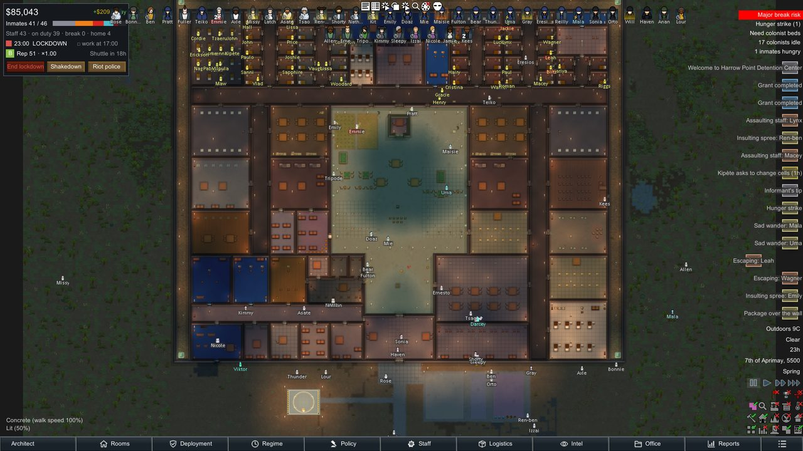

## Building

The build compiles against the game's own DLLs: a RimWorld 1.7 install (the .NET build, with `Assembly-CSharp.dll` at
the install root). The Makefile, the csproj and the test tools look for it in the repo folder or any folder above it,
and in a `RimWorld/` subfolder of each of those (for example `~/RimWorld` next to `~/rim-mods/rim-prison`; see
`tools/rimworld-dir.sh`). Anywhere else, set `RIMWORLD_DIR=/path/to/RimWorld`.

Requirements: .NET SDK 10 (the mod targets `net10.0`), NuGet access for `Lib.Harmony` 3.0.0-rc.3, `make`.

| Target | What it does |
|---|---|
| `make build` | builds the mod into `Mods/RimPrison/Assemblies/` |
| `make lint` | checks every def field and reference against the game's types (no game run) |
| `make link` | symlinks `Mods/RimPrison` into the game's `Mods/` folder so the game loads this checkout |
| `make dist` | writes `dist/RimPrison/` and `dist/RimPrison.zip` (override with `DIST_DIR=`) |
| `make clean` | removes build output |

## Testing

`tools/autotest.sh <days> -rimprison-plan=<plan>` runs a headless game on a generated starter prison, checks it, and
prints PASS or FAIL with the problems found.

- **Plans:** `normal`, `stress`, `events`, `saveload`, `big`, `huge`, `mega` (a 96-inmate scale probe), `deathrow`,
  `finemeals`, `hostage`, and `showcase` (on the state penitentiary).
- **Timings:** with `RIMPRISON_PROBE=1`, the end of the log has `[RimPrison:perf]` lines: the time and calls of the
  mod's passes and of the vanilla calls under them. The timers are off by default because they change how a run plays
  out.
- **Screenshots:** `tools/uitour.sh` runs a windowed tour of every screen and saves a screenshot per step to
  `.work/shots/` (`tools/uitour.sh penitentiary` does it in the state penitentiary). `tools/showcase-shots.sh` takes
  pictures of the prison itself (overview, cell block, canteen at lunch, yard, reception, landing area, chapel, supermax,
  solitary, office, morgue, burial plot, night lockdown)
  into `.work/shots-showcase/`. The save folder these use must list Harmony and this mod in its `ModsConfig.xml`, or the
  game starts without the mod.

All of these run under the headless harness of [ColonyScale](https://github.com/UrekD/ColonyScale)
(`tools/headless/run-game.sh`: offline, Xvfb, the Windows build under portable Wine or a native Linux build). Check it
out next to this repo as `colony-scale`, or point `RW_RUNNER` (or `COLONY_SCALE` for the screenshot tools) at it.
`RW_GAME_DIR=/path/to/RimWorld` picks the install to run, for example a native Linux build; `tools/showcase-shots.sh`
uses a `RimWorld-linux/` folder next to the Windows install when there is one. The pictures in `docs/screenshots/` were
taken this way.

## Sources and credits

Used to build, run or test the mod:

- **[RimWorld](https://rimworldgame.com/)** by Ludeon Studios. The mod compiles against the game's DLLs, and vanilla
  methods were read in decompiled form for reference. That is allowed by the [RimWorld EULA](https://rimworldgame.com/eula/),
  which says mods must be free and must be presented as community-made. No game files or decompiled sources are in
  this repository.
- **[Harmony](https://github.com/pardeike/Harmony)** by Andreas Pardeike (MIT): the patching library (`Lib.Harmony`
  NuGet, compile-time only). At runtime it comes from the **[Harmony mod](https://github.com/pardeike/HarmonyRimWorld)**
  (`brrainz.harmony`, MIT).
- **[ColonyScale](https://github.com/UrekD/ColonyScale)** (Unlicense): the headless test harness. It uses
  **[Wine](https://www.winehq.org/)** (LGPL-2.1+) in the portable builds by
  **[Kron4ek/Wine-Builds](https://github.com/Kron4ek/Wine-Builds)**, **Xvfb** (X.Org) and Mesa's lavapipe for the
  windowed screenshot runs.
- **[ILSpy / ilspycmd](https://github.com/icsharpcode/ILSpy)** (MIT): decompiling the game for reference.
- **.NET SDK** (Microsoft, MIT).

Inspiration (ideas only; no code or art was used):

- **Prison Architect** by Introversion Software: the model for the whole mod: rooms painted as sectors, the daily regime
  per security level, intake, programs and parole, the grades. `DESIGN.md` keeps a list of where the two stand.

AI tools used to write the code are listed in [docs/HOW-IT-WAS-MADE.md](docs/HOW-IT-WAS-MADE.md).

## License

[The Unlicense](LICENSE): public domain, so anyone may do anything with it. No warranty. This covers the code in this
repository only, not RimWorld or the third-party projects above.
